# Dhaks here. 👋

**Generalist developer · Open-source contributor · occasional negotiator with CI**

I build across frontend, backend, and infrastructure—mostly because bugs refuse to respect team boundaries.

## What I'm usually doing

- Building practical software instead of another todo app. The world has enough.
- Making TypeScript behave and writing Swift when pixels need opinions.
- Automating repetitive work, then debugging the automation. Progress is progress.
- Contributing to open source with useful PRs and suspiciously detailed commit messages.

## Tools I reach for

  
  
  
  
  

## Current operating mode

| Signal | Status |
| --- | --- |
| Shipping | Small, useful increments |
| Debugging | The bug and I are getting to know each other |
| Docs | Read before panic. Usually. |
| Collaboration | Open to thoughtful, well-scoped work |

<strong>Highly scientific developer metrics</strong>

 

- Tabs open: a responsible amount, legally speaking.
- “Works on my machine”: currently under peer review.
- TODO comments: some have developed personalities.
- Coffee → code conversion: lossless on good days.

---

<i>I like software that solves the problem before it starts a new one.</i>

